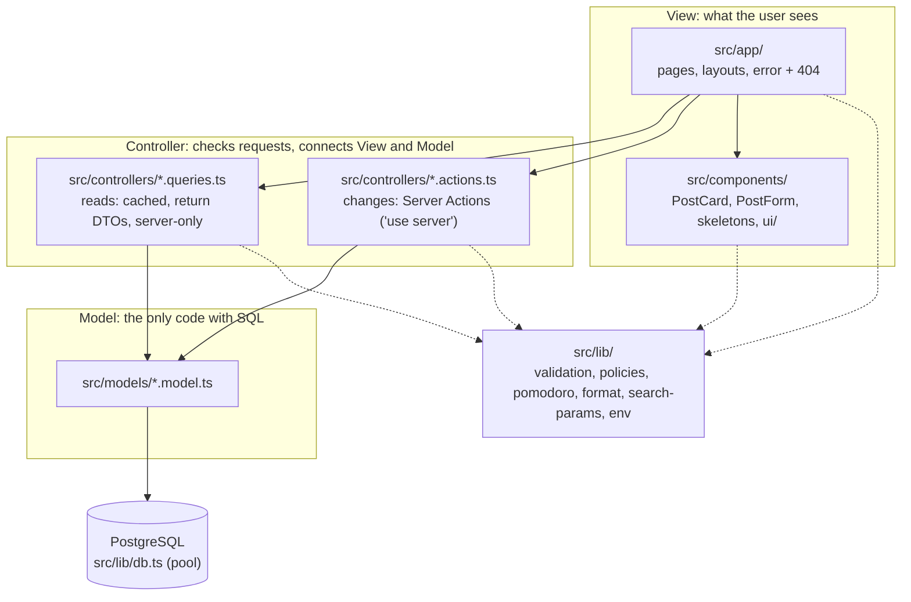

# Architecture

Study Blog uses **MVC** (Model, View, Controller) inside Next.js. Next.js doesn't force MVC,
so we made the folders ourselves, and an **ESLint rule enforces the borders**
(`import/no-restricted-paths` in `eslint.config.mjs`). Breaking a border fails CI.

## The layers

| Folder             | Job                                              | May import                     | Must NOT import                        |
| ------------------ | ------------------------------------------------ | ------------------------------ | -------------------------------------- |
| `src/app/`         | Pages: get data from a controller, render it     | controllers, components, lib   | models, `lib/db.ts`                    |
| `src/components/`  | Reusable UI pieces                               | lib (and controller **types**) | models, `lib/db.ts`, controllers' code |
| `src/controllers/` | Check input, call models, clear caches, redirect | models, lib, `next/*`          | app, components                        |
| `src/models/`      | SQL + turning rows into TypeScript objects       | `lib/db.ts`                    | controllers, app, components, `next/*` |
| `src/lib/`         | Small shared helpers                             | other lib files                | everything above                       |

Why so strict? In M8 we replace the whole Model layer with Drizzle ORM. If only controllers
talk to models, and models know nothing about Next.js, that swap touches one folder, and the
tests prove nothing else broke.

## Reads and writes

- **Reads** (`*.queries.ts`) use `"use cache"` with a `cacheTag`, and return **DTOs** (only the fields
  a page needs, so `password_hash` can't leak). `import "server-only"` makes the build fail if a
  Client Component ever imports them.
- **Writes** (`*.actions.ts`) are **public endpoints**: anyone can POST to them. Each one checks its
  input, checks who is asking (`requireUser()`) and whether they may do it (`canEditPost()`), then calls the model,
  then `updateTag(...)`, then `redirect(...)`.

## Who is asking? (M3)

- `src/controllers/session.ts` reads the login cookie: `getCurrentUser()` hashes the token and finds a valid session.
  Pages call it inside `<Suspense>` (it reads a cookie, so it's per request). React's `cache()` makes it run once per request.
- Every Server Action that changes data calls `requireUser()` **itself**. Hiding a button is not security, and
  `src/proxy.ts` (a quick "is there a cookie at all?" redirect) isn't either.
- Pure helpers with no database live in `src/lib/auth/` (password hashing, tokens, cookie settings, the `?next=` check).

## What may they do? (M4)

- `src/lib/policies.ts` holds the rules as pure functions. `canEditPost(user, post)`: the author or an admin, never a guest.
- The **same** function is used in three places:
  - the actions `updatePost` / `deletePost`: **the real protection**. No post → `notFound()` (404), not allowed → `forbidden()` (403);
  - the edit page: someone else's post shows `src/app/forbidden.tsx`;
  - the post page: Edit and Delete only show when it says yes (comfort only).
- The permission is checked **before** the form is read, so a stranger learns nothing from validation errors.
- `forbidden()` is experimental in Next.js 16: it needs `experimental.authInterrupts` in `next.config.ts`.

## The Study page (M5): server and browser together

- **Server:** `requireUser()`, then `getStudyStats()` (6 small SQL queries in `study-session.model.ts`), shown by
  `StudyStatsView` (a Server Component: HTML only).
- **Browser:** `PomodoroTimer` (`"use client"`). The rules are pure functions in `src/lib/pomodoro.ts`; the component only
  connects them to buttons, `localStorage` (keys include the user id) and the Server Action `saveStudySession`.
- **Saving a round:** the browser sends `{ durationMinutes, topic }` only. The server sets the user (session) and the
  day (`(now() AT TIME ZONE users.time_zone)::date`), then calls `refresh()` so the stats render again.
- **No cache** for the stats: they belong to one user and change after every round, so they are read per request.

## Rendering (Cache Components)

The page frame (the **static shell**) is built once and sent at once. Anything that needs the request
(the URL's `?before=`, the post id, later the login cookie) streams in inside `<Suspense>`, with a
skeleton from the Loading board first.

| Page                  | In the static shell          | Streams in                          |
| --------------------- | ---------------------------- | ----------------------------------- |
| `/`                   | header, heading, "About" box | the post list (cached, tag `posts`) |
| `/posts/[id]`         | header, "All posts" link     | the post (cached, tag `post:<id>`)  |
| `/posts/[id]/edit`    | header, heading              | the form, after the owner check     |
| `/posts/new`          | header, heading              | the form, after the login check     |
| `/login`, `/register` | header, heading              | the form (it reads `?next=`)        |
| `/study`              | header, heading              | the timer, then the stats           |

`pnpm build` shows this: `○` = fully static, `◐` = static shell + streamed parts.
No page reads the database while building, so the build doesn't need a database.
