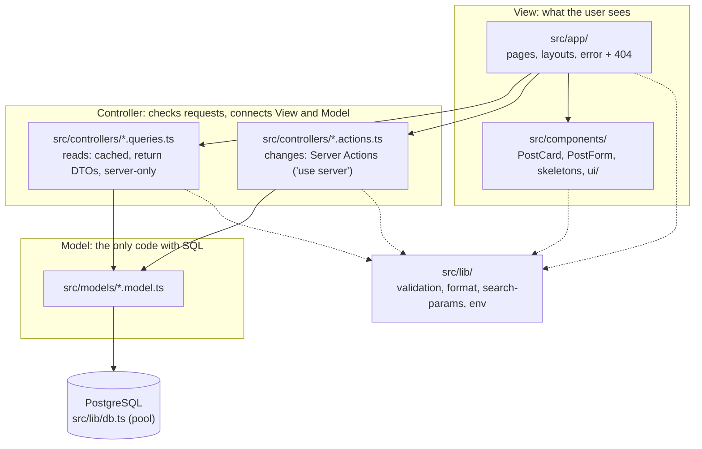

# Architecture

Study Blog uses **MVC** (Model, View, Controller) inside Next.js. Next.js doesn't force MVC,
so we made the folders ourselves, and an **ESLint rule enforces the borders**
(`import/no-restricted-paths` in `eslint.config.mjs`). Breaking a border fails CI.

## The layers

| Folder             | Job                                              | May import                     | Must NOT import                        |
| ------------------ | ------------------------------------------------ | ------------------------------ | -------------------------------------- |
| `src/app/`         | Pages: get data from a controller, render it     | controllers, components, lib   | models, `lib/db.ts`                    |
| `src/components/`  | Reusable UI pieces                               | lib (and controller **types**) | models, `lib/db.ts`, controllers' code |
| `src/controllers/` | Check input, call models, clear caches, redirect | models, lib, `next/*`          | app, components                        |
| `src/models/`      | SQL + turning rows into TypeScript objects       | `lib/db.ts`                    | controllers, app, components, `next/*` |
| `src/lib/`         | Small shared helpers                             | other lib files                | everything above                       |

Why so strict? In M8 we replace the whole Model layer with Drizzle ORM. If only controllers
talk to models, and models know nothing about Next.js, that swap touches one folder, and the
tests prove nothing else broke.

## Reads and writes

- **Reads** (`*.queries.ts`) use `"use cache"` with a `cacheTag`, and return **DTOs** (only the fields
  a page needs, so `password_hash` can't leak). `import "server-only"` makes the build fail if a
  Client Component ever imports them.
- **Writes** (`*.actions.ts`) are **public endpoints**: anyone can POST to them. Each one checks its
  input with Zod (and from M3/M4, who is asking), then calls the model, then `updateTag(...)`,
  then `redirect(...)`.

## Rendering (Cache Components)

The page frame (the **static shell**) is built once and sent at once. Anything that needs the request
(the URL's `?before=`, the post id, later the login cookie) streams in inside `<Suspense>`, with a
skeleton from the Loading board first.

| Page               | In the static shell          | Streams in                          |
| ------------------ | ---------------------------- | ----------------------------------- |
| `/`                | header, heading, "About" box | the post list (cached, tag `posts`) |
| `/posts/[id]`      | header, "All posts" link     | the post (cached, tag `post:<id>`)  |
| `/posts/[id]/edit` | header, heading              | the form with the post's text       |
| `/posts/new`       | everything (fully static)    | —                                   |

`pnpm build` shows this: `○` = fully static, `◐` = static shell + streamed parts.
No page reads the database while building, so the build doesn't need a database.
