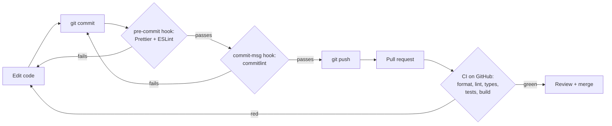

# M0 — Project setup and CI

> **Goal:** set up the project and its safety checks _before_ writing features.
> Like a chef who sets up a clean kitchen, sharp knives and a fire alarm before cooking.

## What we built

- A Next.js app with TypeScript and Tailwind CSS.
- Design tokens (colors, fonts, radius) copied from the Claude Design style guide.
- shadcn/ui, with a `Button` resized to the design (44 px touch targets).
- Tools that check the code: Prettier, ESLint, TypeScript, Vitest.
- Git hooks that run checks before each commit.
- A GitHub Actions **CI** workflow that runs all checks on every pull request.
- Dependabot, which opens PRs to update packages every week.

## Each tool in one sentence

| Tool                    | Simple explanation                                                        | Metaphor                                 |
| ----------------------- | ------------------------------------------------------------------------- | ---------------------------------------- |
| **Node.js**             | Runs JavaScript outside the browser.                                      | The kitchen's electricity                |
| **pnpm**                | Installs packages (code other people wrote).                              | The supermarket delivery                 |
| **`pnpm-lock.yaml`**    | Records the _exact_ version of every package.                             | A receipt, so the next order is the same |
| **Next.js**             | A framework for React apps: pages, routing, server code, building.        | The kitchen layout                       |
| **TypeScript**          | JavaScript plus types. It catches mistakes before the code runs.          | Labels on every box: "eggs", "flour"     |
| **Tailwind CSS**        | Style elements with small class names like `text-primary`.                | A spice rack with fixed jars             |
| **Design tokens**       | Our colors and sizes stored once in `globals.css`.                        | Paint swatches on one card               |
| **shadcn/ui**           | Ready-made UI components that are copied into _our_ code, so we own them. | A recipe you copy into your own book     |
| **ESLint**              | Finds bugs and bad patterns in code.                                      | A grammar checker                        |
| **Prettier**            | Formats code the same way every time.                                     | Auto-tidy for your desk                  |
| **Vitest**              | Runs tests: small programs that check our code works.                     | A taste test before serving              |
| **Testing Library**     | Lets tests look at a page the way a user does (by role and text).         | A robot customer                         |
| **Husky + lint-staged** | Run Prettier and ESLint on changed files _before_ each commit.            | A guard at the kitchen door              |
| **commitlint**          | Checks the commit message format (`feat: …`, `fix: …`).                   | A rule for writing order slips           |
| **GitHub Actions (CI)** | Runs every check on a fresh computer for each push and PR.                | A food inspector who checks every dish   |
| **Dependabot**          | Opens PRs when packages have new versions or security fixes.              | A reminder to restock and check expiry   |

## The journey of a change

Problems are caught as early (and cheaply) as possible: first on your computer, then in CI, and only rarely in production.

## Why CI matters: "it works on my machine"

Your laptop has extra files, old packages and settings that other computers don't have.
CI starts from **zero** every time: a fresh Linux machine, `pnpm install --frozen-lockfile`, then all checks.
If CI is green, the code works from a clean start, not only on your laptop.

`--frozen-lockfile` means "install exactly what the lockfile says, and fail if `package.json` and the lockfile disagree".
So CI never quietly installs different versions from your laptop.

## Conventional Commits

Commit messages start with a **type**:

| Type       | Use it for                                | Example                               |
| ---------- | ----------------------------------------- | ------------------------------------- |
| `feat`     | A new feature                             | `feat: add post list page`            |
| `fix`      | A bug fix                                 | `fix: show error when title is empty` |
| `docs`     | Docs only                                 | `docs: explain migrations`            |
| `test`     | Adding or fixing tests                    | `test: cover canEditPost rules`       |
| `refactor` | Code change that doesn't change behaviour | `refactor: move SQL into post model`  |
| `chore`    | Tooling, config, dependencies             | `chore: add Prettier`                 |
| `ci`       | CI workflow changes                       | `ci: cache Next.js build`             |

Why? The history becomes easy to read, and tools can create changelogs automatically.

## A real bug we found while setting up

The outline button had **no border** on the home page.

- `buttonVariants()` (from the `cva` library) only **joins** class names together.
- The base classes include `border-transparent` and the outline variant adds `border-border`.
- Both classes ended up on the element and fought. The transparent one won.
- `cn()` **merges** Tailwind classes. When two classes set the same thing, the last one wins.

Fix: `className={cn(buttonVariants({ variant: "outline" }))}`.
Lesson: we found it by **looking at a screenshot**, not by tests. Visual checks matter too.

## Cache Components (a new Next.js default)

Next.js 16.4 turns on **Cache Components** by default (`cacheComponents: true` in `next.config.ts`).
Short version: pages are fast static HTML by default, and anything that needs fresh data (the database, cookies) must say so.
We will learn this properly in M2, when the first page reads from the database.

## Common mistakes

- **Committing `.env.local`.** It can hold passwords. `.gitignore` blocks it; only `.env.example` (no secrets) is committed.
- **Deleting the lockfile to "fix" an install.** You lose the exact versions. Fix the conflict instead.
- **`git commit --no-verify`.** This skips the hooks. CI will still catch the problem, just later.
- **Ignoring a red CI.** Never merge red. Read the failing step's log first.

## Try it yourself

1. In `src/app/page.tsx`, change `text-primary` to `text-break` on the badge. Run `pnpm dev`. What color does it become? Where is that color defined?
2. Write a commit with the message `added stuff`. What does commitlint say? Fix it with a real type.
3. Break a test on purpose: change the heading text in `page.tsx` and run `pnpm test`. Read the error, then undo it.

## Interview questions you can now answer

- **What is CI and why use it?** A server runs all checks (lint, types, tests, build) on every push from a clean start, so broken code is caught before it is merged.
- **What is a lockfile?** A file with the exact version of every package, so every machine installs the same code.
- **ESLint vs Prettier?** ESLint finds code problems; Prettier only formats. `eslint-config-prettier` turns off ESLint's style rules so the two don't fight.
- **Why Git hooks if we have CI?** Faster feedback. A hook catches a problem in seconds on your laptop; CI catches it minutes later.
- **What are design tokens?** Named design values (like `--primary: #2f5bea`) stored in one place, so the design and the code stay in sync.
