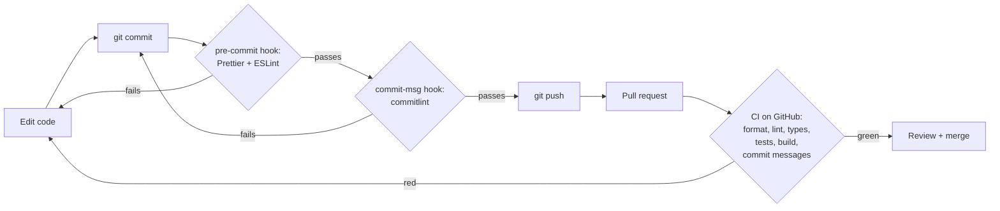

# M0 — Project setup and CI

> **Goal:** set up the project and its safety checks _before_ writing features.
> Like a chef who sets up a clean kitchen, sharp knives and a fire alarm before cooking.

## What we built

- A Next.js app with TypeScript and Tailwind CSS, running on **Node.js 24 LTS** with **pnpm 11**.
- Design tokens (colors, text sizes, radius, widths) copied from the Claude Design style guide.
  [`docs/design-tokens.md`](../design-tokens.md) maps each design name to its code name.
- shadcn/ui, with a `Button` resized to the design (44 px touch targets only).
- Tools that check the code: Prettier, ESLint (no warnings allowed), TypeScript, Vitest.
- Git hooks that run checks before each commit.
- A GitHub Actions **CI** workflow with 2 jobs: the code checks, and a commit-message check.
- Dependabot, which opens PRs to update packages every week.

## Each tool in one sentence

| Tool                    | Simple explanation                                                             | Metaphor                                 |
| ----------------------- | ------------------------------------------------------------------------------ | ---------------------------------------- |
| **Node.js**             | Runs JavaScript outside the browser.                                           | The kitchen's electricity                |
| **pnpm**                | Installs packages (code other people wrote).                                   | The supermarket delivery                 |
| **`pnpm-lock.yaml`**    | Records the _exact_ version of every package.                                  | A receipt, so the next order is the same |
| **Next.js**             | A framework for React apps: pages, routing, server code, building.             | The kitchen layout                       |
| **TypeScript**          | JavaScript plus types. It catches mistakes before the code runs.               | Labels on every box: "eggs", "flour"     |
| **Tailwind CSS**        | Style elements with small class names like `text-primary`.                     | A spice rack with fixed jars             |
| **Design tokens**       | Our colors and sizes stored once in `globals.css`.                             | Paint swatches on one card               |
| **shadcn/ui**           | Ready-made UI components that are copied into _our_ code, so we own them.      | A recipe you copy into your own book     |
| **ESLint**              | Finds bugs and bad patterns in code.                                           | A grammar checker                        |
| **Prettier**            | Formats code the same way every time.                                          | Auto-tidy for your desk                  |
| **Vitest**              | Runs tests: small programs that check our code works.                          | A taste test before serving              |
| **Testing Library**     | Lets tests look at a page the way a user does (by role and text).              | A robot customer                         |
| **Husky + lint-staged** | Run Prettier and ESLint on changed files _before_ each commit.                 | A guard at the kitchen door              |
| **commitlint**          | Checks the commit message format (`feat: …`, `fix: …`).                        | A rule for writing order slips           |
| **GitHub Actions (CI)** | Runs every check on a fresh computer for each pull request and push to `main`. | A food inspector who checks every dish   |
| **Dependabot**          | Opens PRs when packages have new versions.                                     | A reminder to restock                    |

Dependabot's **security-fix** PRs are a separate switch in the repo settings
(Settings → Advanced Security → Dependabot security updates). `dependabot.yml` only controls the normal weekly updates.

## The journey of a change



Problems are caught as early (and cheaply) as possible: first on your computer, then in CI, and only rarely in production.

## Why CI matters: "it works on my machine"

Your laptop has extra files, old packages and settings that other computers don't have.
CI starts from **zero** every time: a fresh Linux machine, `pnpm install --frozen-lockfile`, then all checks.
If CI is green, the code works from a clean start, not only on your laptop.

`--frozen-lockfile` means "install exactly what the lockfile says, and fail if `package.json` and the lockfile disagree".
So CI never quietly installs different versions from your laptop.

Two small safety rules in our workflow:

- Each action is pinned to a **commit SHA** (`actions/checkout@3d3c42e…  # v7.0.1`), not a tag like `v7`.
  A tag is a sticky note that someone can move to other code. A SHA is a fingerprint: it can't change.
- `persist-credentials: false`: CI doesn't keep the GitHub token on disk, because it never needs to push.

## Supply-chain safety: the 1-day wait

A **supply-chain attack** is when someone hacks a popular package and publishes a bad version.
Everyone who installs it in the next hours gets the bad code. Most bad versions are found and removed within a day or two.

pnpm 11 has a rule called `minimumReleaseAge`: by default it **won't install a version that is less than 1 day old**.
This happened to us: Next.js 16.4.5 came out the day before, so pnpm refused it, and we used 16.4.4 instead.
(We checked first: 16.4.4 has no known security problems.) Dependabot has the same idea, called `cooldown`.

Metaphor: you don't eat food from a new stall on its first day. You wait one day and see if anyone got sick.

## Version choices (Nov 2026)

| Tool       | Version | Why                                                                                         |
| ---------- | ------- | ------------------------------------------------------------------------------------------- |
| Node.js    | 24 LTS  | Supported until Apr 2028. Node 22 support ends Apr 2027. Node 25+ doesn't include Corepack. |
| pnpm       | 11      | Current version, with the 1-day wait above.                                                 |
| ESLint     | 10      | ESLint 9 stopped getting updates in Aug 2026. Next.js 16.4 supports ESLint 10.              |
| TypeScript | 5.9     | TypeScript 7 exists, but the ESLint TypeScript tools don't support it yet.                  |

Some ESLint plugins inside `eslint-config-next` don't _say_ they support ESLint 10 yet, even though they work.
The Next.js docs mention this, so `pnpm-workspace.yaml` tells pnpm "this is OK".

## Conventional Commits

Commit messages start with a **type**:

| Type       | Use it for                                | Example                               |
| ---------- | ----------------------------------------- | ------------------------------------- |
| `feat`     | A new feature                             | `feat: add post list page`            |
| `fix`      | A bug fix                                 | `fix: show error when title is empty` |
| `docs`     | Docs only                                 | `docs: explain migrations`            |
| `test`     | Adding or fixing tests                    | `test: cover canEditPost rules`       |
| `refactor` | Code change that doesn't change behaviour | `refactor: move SQL into post model`  |
| `chore`    | Tooling, config, dependencies             | `chore: add Prettier`                 |
| `ci`       | CI workflow changes                       | `ci: cache Next.js build`             |

Why? The history becomes easy to read, and tools can create changelogs automatically.
The Git hook checks each message on your laptop, and the "Commit messages" CI job checks every commit in the PR again.

## Two real bugs we found while setting up

Both bugs are about the same idea: **two classes that set the same thing**.

### Bug 1: the outline button had no border

- `buttonVariants()` (from the `cva` library) only **joins** class names together.
- The base classes include `border-transparent`, and the outline variant adds `border-border`. Both ended up on the element.
- When two classes set the same thing, the browser doesn't look at the order inside `class="…"`.
  It uses the rule that comes **later in the stylesheet**. Tailwind decides that order when it builds the CSS, not you.
  In our build `.border-transparent` came later, so the border was invisible.
- `cn()` fixes this. It **deletes the earlier class** that conflicts, so only `border-border` is left.

Fix: `className={cn(buttonVariants({ variant: "outline" }))}`. We found it by **looking at a screenshot**, not by a test.

### Bug 2: cn() deleted the button's text color

We added our own text sizes (`text-label`, `text-body`, …) from the style guide. Then `cn()` broke the main button:

```ts
cn("text-primary-foreground", "text-label"); // gave "text-label": the white text color was deleted!
```

`cn()` only knows Tailwind's built-in sizes (`text-sm`, `text-lg`, …). For an unknown `text-something`, it guesses "this is a color".
So it saw two colors and deleted the first one. The fix in `src/lib/utils.ts`: tell `cn()` our size names.
An ESLint rule now makes everyone import `cn` from `@/lib/utils`, not straight from the `cn` package.

Lesson: after we found each bug, we wrote a **regression test** (`tests/unit/button.test.tsx`, `tests/unit/home-page.test.tsx`).
A regression test fails if the same bug ever comes back.

## Contrast: numbers, not feelings

The team-lead review measured our colors with the WCAG contrast formula:

| Thing                             | Before             | After                       | Rule           |
| --------------------------------- | ------------------ | --------------------------- | -------------- |
| Input border on white             | `#E3E6EB`, 1.25:1  | `#878E9B`, 3.3:1            | at least 3:1   |
| Keyboard focus ring               | blue at 50%, 2.2:1 | solid blue, 2 px gap, 5.5:1 | at least 3:1   |
| White text on hovered blue button | `#597CEE`, 3.8:1   | `#1F44C4`, 7.8:1            | at least 4.5:1 |

Light gray "looks clean", but some people can't see it. So we check the numbers.

## Cache Components (a new Next.js setting)

`create-next-app` turns on **Cache Components** for new projects (`cacheComponents: true` in `next.config.ts`).
Next.js itself will turn it on for everyone in its next major version.

Short version: Next.js builds a fast **static shell** of each page ahead of time.
Database and cookie reads happen **at request time**, so they must sit inside `<Suspense>` (or be cached with `'use cache'`).
If you read cookies outside `<Suspense>`, the build fails. We will learn this properly in M2, when the first page reads from the database.

## Why some packages are in `dependencies`

`shadcn` and `tw-animate-css` are only used while building the CSS, not in the browser.
shadcn's setup puts them in `dependencies` because `globals.css` imports them. This is harmless.

`"prepare": "husky"` installs the Git hooks after `pnpm install`. In CI it sets them up too (harmless, CI never commits).
Where there is no `.git` folder, husky prints a short message and exits, so the build doesn't break.
(A future Dockerfile that installs only production packages would break, because husky itself isn't installed there.
We'll handle that when we write one.)

## Common mistakes

- **Committing `.env.local`.** It can hold passwords. `.gitignore` blocks it; only `.env.example` (no secrets) is committed.
- **Deleting the lockfile to "fix" an install.** You lose the exact versions. Fix the conflict instead.
- **`git commit --no-verify`.** This skips the hooks. CI still checks the format, lint and commit messages, just later.
- **Ignoring a red CI.** Never merge red. Read the failing step's log first.
- **Ignoring warnings.** `pnpm lint` fails on any warning, so warnings can't pile up.

## Try it yourself

1. In `src/app/page.tsx`, change `text-primary` to `text-break` on the badge. Run `pnpm dev`. What color does it become? Where is that color defined?
2. Write a commit with the message `added stuff`. What does commitlint say? Fix it with a real type.
3. Break a test on purpose: change the heading text in `page.tsx` and run `pnpm test`. Read the error, then undo it.
4. In `src/lib/utils.ts`, remove `"label"` from `TEXT_SIZES` and run `pnpm test`. Which test catches Bug 2? Undo it.

## Interview questions you can now answer

- **What is CI and why use it?** A server runs all checks (lint, types, tests, build) on every PR from a clean start, so broken code is caught before it is merged.
- **What is a lockfile?** A file with the exact version of every package, so every machine installs the same code.
- **ESLint vs Prettier?** ESLint finds code problems; Prettier only formats. `eslint-config-prettier` turns off ESLint's style rules so the two don't fight.
- **Why Git hooks if we have CI?** Faster feedback. A hook catches a problem in seconds on your laptop; CI catches it minutes later, and nobody can skip it.
- **What are design tokens?** Named design values (like `--primary: #2f5bea`) stored in one place, so the design and the code stay in sync.
- **What is a regression test?** A test written after fixing a bug, so the bug can't come back without a red test.
- **What is a supply-chain attack, and how can you reduce the risk?** A hacked package version. Wait a few days before installing new versions (`minimumReleaseAge`, Dependabot `cooldown`), and pin CI actions to SHAs.
