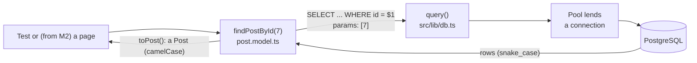

# M1 — Database and Models

> **Goal:** give the app a memory. Users and posts live in a real PostgreSQL database,
> and only the **Model** layer talks to it.
>
> Metaphor: a library archive. The **database** is the archive room, each **table** is a shelf,
> each **row** is a box. The **model** is the only librarian allowed inside.

## What we built

- A local PostgreSQL 17 in Docker (`docker-compose.yml`), started with one command.
- `src/lib/env.ts`: checks `DATABASE_URL` with Zod and explains what's wrong if it's missing.
- `src/lib/db.ts`: one shared **connection pool** and a `query()` helper that always uses parameters.
- A small **migration runner** (`src/lib/migrations.ts` + `pnpm db:migrate`).
- `0001_create_users.sql`, and your `0002_create_posts.sql` (Task 1).
- **Models**: `user.model.ts` and `post.model.ts`, the only files with SQL.
- `pnpm db:seed` (demo data) and `pnpm db:reset` (rebuild your local database from zero).
- **Database tests** on a real Postgres, in a separate `_test` database. CI starts its own Postgres too.

## Key words

| Word                     | Simple meaning                                                            | Metaphor                                     |
| ------------------------ | ------------------------------------------------------------------------- | -------------------------------------------- |
| **Table / row / column** | A shelf / one box on it / one label on every box                          | Shelf, box, label                            |
| **Schema**               | The list of tables and their columns and rules                            | The building plan of the archive             |
| **Migration**            | A numbered SQL file that changes the schema. Runs once, then logged       | A numbered renovation, written in a log book |
| **Constraint**           | A rule the database enforces: `NOT NULL`, `UNIQUE`, `CHECK`, `REFERENCES` | The librarian's rules                        |
| **Primary key**          | The id that makes each row unique (`id`)                                  | The number on each box                       |
| **Foreign key**          | A column that points to a row in another table (`author_id` → `users.id`) | "This box belongs to shelf 3, box 12"        |
| **Index**                | A sorted list that makes finding rows fast                                | The index at the back of a book              |
| **Parameterized query**  | SQL with `$1, $2`; the values are sent separately                         | A form with blanks to fill in                |
| **Connection pool**      | A few database connections, shared and reused                             | A key ring                                   |
| **Transaction**          | A group of SQL statements that all work, or none of them do               | "All or nothing"                             |
| **Seed**                 | Demo data, so the app isn't empty                                         | Sample books on the shelves                  |

## The journey of a query



The model is the **start and the end** of the trip: it writes the SQL, and it turns the rows into TypeScript objects.

## Docker in 2 minutes

Docker runs PostgreSQL in a sealed box on your laptop, so you don't install it into Windows or macOS.
Everyone (you, me, CI) gets exactly the same PostgreSQL 17.

Metaphor: a video game.

| Word               | Simple meaning                                                                  | Game metaphor            |
| ------------------ | ------------------------------------------------------------------------------- | ------------------------ |
| **Image**          | A ready-made package with a program inside (ours: `postgres:17-alpine`)         | The game installer       |
| **Container**      | A running copy of an image (ours is called `db`)                                | The game, running        |
| **Volume**         | Storage that stays when the container is stopped or deleted (ours: `db-data`)   | The save file            |
| **Docker Compose** | `docker-compose.yml`: one file that says which containers to start, and how     | The game's settings file |
| **Port**           | `5432:5432` connects port 5432 on your laptop to port 5432 inside the container | The door into the box    |

You can delete and re-create the container at any time. Your data lives in the volume, like a save file.

`pnpm db:up` runs `docker compose up -d --wait`. It reads `docker-compose.yml`, downloads the image the first time (about 100 MB),
starts the container in the background (`-d`), and waits until PostgreSQL says it's ready (`--wait`).
On the very first start only, it also runs `db/init/01-create-test-db.sql`, which creates the `study_blog_test` database.

**In Docker Desktop**, after `pnpm db:up`:

- **Containers**: a group called `study-blog-platform` with `db-1` inside, a green dot, and the port `5432:5432`.
  The ■ / ▶ buttons stop and start it. Click it to see its **Logs** (PostgreSQL's messages).
- **Images**: `postgres` with the tag `17-alpine`.
- **Volumes**: `study-blog-platform_db-data`. This is your data.
- You can ignore the rest for now (Gordon, Kubernetes, Models, MCP Toolkit, Builds, Extensions). You don't need to sign in.

Docker Desktop must be open ("Engine running" at the bottom left) before any `docker` or `pnpm db:*` command works.

| I want to…                                 | Command                                     |
| ------------------------------------------ | ------------------------------------------- |
| Start the database                         | `pnpm db:up`                                |
| Stop it (your data is kept)                | `pnpm db:down`                              |
| Check if it's running                      | `docker compose ps`                         |
| Read its messages                          | `docker compose logs db`                    |
| Type SQL inside it                         | `pnpm db:psql`                              |
| Delete **all** local data, start from zero | `docker compose down -v`, then `pnpm db:up` |

If something goes wrong:

- **"Cannot connect to the Docker daemon"** or **"error during connect"**: Docker Desktop isn't open. Open it and wait for "Engine running".
- **"port is already allocated"** or **"password authentication failed for user "study""**: another PostgreSQL already uses port 5432
  (for example, one you installed for a uni course). On Windows: Win + R → `services.msc` → find `postgresql-x64-…` → Stop,
  and set "Startup type" to Manual. Then run `pnpm db:up` again.
- **"database "study_blog_test" does not exist"**: the init script only runs when the volume is new.
  Run `docker compose down -v`, then `pnpm db:up`.

## Start here (on your laptop)

### 1. Get the M1 branch

After you merged PR #1, I rebuilt this branch on top of the new `main`. Your laptop still has the old M0 copy,
so a plain `git pull` would fail with "divergent branches". These commands make your branch the same as GitHub's.

First check that you have no unsaved changes. It must say "nothing to commit, working tree clean":

```bash
git status
```

```bash
git fetch origin
```

```bash
git checkout -B tnt57/focused-hopper-v5osaw origin/tnt57/focused-hopper-v5osaw
```

`-B` means "create this branch, or reset it if it already exists". Use the same `git fetch` + `git checkout -B` at the start of every milestone.

Then install the new packages (`pg`, `zod`, `tsx`):

```bash
pnpm install
```

### 2. Start the database and look inside

Copy the example settings. They already have the right values for the Docker database:

```bash
cp .env.example .env.local
```

```bash
pnpm db:up
```

It ends with `Container study-blog-platform-db-1 Healthy`. Now create the tables:

```bash
pnpm db:migrate
```

You should see `✓ 0001_create_users.sql` and `Done: 1 migration(s).` Run it again: now it says "Nothing to do".
That's the migration log (`schema_migrations`) at work. Now look inside:

```bash
pnpm db:psql
```

Inside `psql`, try `\dt` (list tables), `\d users` (columns, indexes and rules) and `SELECT * FROM schema_migrations;`.
Type `\q` to leave. After Task 1 you can also run `pnpm db:seed` and `SELECT * FROM posts;`.

## Your turn

The tests for both tasks are already written and **red**. Your job is to make them green.
This way of working is called **TDD** (test-driven development): red → write code → green.

The database must be running (`pnpm db:up`, also after every laptop restart). Run the database tests:

```bash
pnpm test:db
```

You should see **14 failed** and the rest passed. The failures say `relation "posts" does not exist` (Task 1)
and `TODO(you)` (Task 2).

The test database is rebuilt from zero on **every** test run, so you can change your SQL and run the tests again as often as you like.

### Task 1: the `posts` table

Create the file **`db/migrations/0002_create_posts.sql`** with a `posts` table:

| Column       | What it holds                                                                                                 |
| ------------ | ------------------------------------------------------------------------------------------------------------- |
| `id`         | A number the database picks (copy the idea from `users`)                                                      |
| `author_id`  | The id of the user who wrote it. Must be a real user. **If the user is deleted, their posts are deleted too** |
| `title`      | Required text, 1–120 characters, and not only spaces                                                          |
| `content`    | Required text, 1–20 000 characters, and not only spaces                                                       |
| `created_at` | When it was written (`timestamptz`), filled in by the database                                                |
| `updated_at` | When it was last changed (`timestamptz`), filled in by the database                                           |

Also add an **index on `author_id`**, so "all posts by this user" stays fast.

Hints:

- Look at `db/migrations/0001_create_users.sql`. It has almost everything you need.
- Useful SQL: `REFERENCES users (id) ON DELETE CASCADE`, `CHECK (...)`, `char_length(x)`,
  `btrim(x)` (removes spaces at both ends), `DEFAULT now()`, `CREATE INDEX name ON table (column);`

Done when: the 6 tests in `tests/db/posts-table.test.ts` and the 5 first tests in `tests/db/post.model.test.ts` are green.

### Task 2: `findPostById()`

In **`src/models/post.model.ts`**, replace the `throw new Error("TODO(you)...")` line with a real query:

- a `SELECT` of the 6 columns, `FROM posts`, `WHERE id = $1`, with `[id]` as the parameters;
- return `toPost(...)` of the first row, or `null` if there is no row.

Hint: `findUserById()` in `src/models/user.model.ts` has the same shape.

Done when: the 3 tests in `findPostById (Task 2)` are green, and `pnpm check` is all green.

**Bonus (2 minutes):** change your query to the _wrong_ way on purpose, gluing the id into the text:
`` `... WHERE id = ${id}` ``. Run `pnpm test:db`. Which test turns red, and why? Then change it back.

### When both tasks are green

Commit each task on its own, with a Conventional Commit message, then push:

```bash
git add db/migrations/0002_create_posts.sql
```

```bash
git commit -m "feat(db): add the posts table"
```

```bash
git add src/models/post.model.ts
```

```bash
git commit -m "feat(db): add findPostById"
```

```bash
git push
```

Then tell me in chat. I'll review your code like a senior developer would. Stuck? Paste your code in chat; that's completely fine.

## Two "type traps" in node-postgres

1. **Big numbers come back as text.** `COUNT(*)` and `SUM(...)` return `bigint`, and `pg` turns `bigint` into a
   **string**, because some bigints are too large for a JS number. So `"50" + "25"` would give `"5025"`!
   Our rule: cast in SQL, `COUNT(*)::int`. Our ids are `integer`, so they are normal numbers.
2. **Dates can move a day.** A `DATE` like `2026-11-04` would become a JS `Date` at midnight _in the server's
   time zone_, which can show as 3 November somewhere else. `src/lib/db.ts` keeps `DATE` as plain text.

## Why the database checks rules too (not only Zod)

Zod (from M2) checks the form and shows friendly messages. But data can reach the database in other ways:
a seed script, a bug in a new action, a future admin tool, or someone typing SQL by hand.
**The database is the last guard, and nobody can skip it.**
Metaphor: Zod is the guard at the shop door; the database is the lock on the safe.

## Migration rules

See [`db/migrations/README.md`](../../db/migrations/README.md). The most important one:
**never edit a migration after it is merged**. Other databases have already run it and will never run it again.
Write a new numbered file instead.

## Common mistakes

- **Gluing values into SQL** (`"WHERE id = " + id`). That's SQL injection. Always use `$1` and the params array.
- **Editing a merged migration.** Write a new file instead.
- **Forgetting `::int` on `COUNT`/`SUM`.** You get strings, and maths silently goes wrong.
- **Running tests on your dev database.** Our test setup refuses any database whose name doesn't end in `_test`.
- **Committing `.env.local`.** It's in `.gitignore`. Keep it that way.

## Try it yourself (in `pnpm db:psql`)

1. Run `\d users`. Find the two unique indexes. Why are they on `lower(email)` and not on `email`?
2. Break a rule on purpose: `INSERT INTO users (username, email, password_hash) VALUES ('a', 'a@b.c', '!');`
   Which rule stops it? Read the error message.
3. After Task 1 and `pnpm db:seed`: count posts per user with
   `SELECT u.username, COUNT(p.id)::int FROM users u LEFT JOIN posts p ON p.author_id = u.id GROUP BY u.username;`
   What changes if you use `JOIN` instead of `LEFT JOIN`?

## Interview questions you can now answer

- **What is a migration, and why keep it as a file in Git?** A numbered schema change that runs once.
  In Git, every database (laptop, CI, production) gets the same schema in the same order, and you can review it.
- **What is SQL injection, and how do you stop it?** User input that gets run as SQL. Parameterized queries
  send the values separately, so they are always data, never code.
- **Why use a connection pool?** Opening a connection is slow. A pool reuses a few connections for many queries.
- **Primary key vs foreign key?** A primary key identifies a row. A foreign key points to a row in another
  table, and the database makes sure that row exists.
- **What does `ON DELETE CASCADE` do?** When the parent row is deleted, its child rows are deleted too.
- **Keyset vs OFFSET pagination?** `OFFSET 1000` still reads and skips 1000 rows, and items shift when new rows arrive.
  Keyset (`WHERE id < last_seen_id`) jumps straight there, and nothing is skipped or shown twice.
