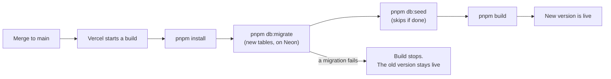

# M1b — First deploy (Vercel + Neon)

> **Goal:** the blog is online with a real link, and every pull request gets its own preview link.
>
> Metaphor: until now the restaurant only opened in your kitchen at home (`localhost`).
> **Vercel** is the restaurant building in the city: anyone can walk in.
> **Neon** is the cold storage room next door: the database, in the cloud.

## What we set up

- A **Vercel project** linked to the GitHub repo:
  - every push to `main` → a new **production** deploy (the public link);
  - every pull request → a **preview** deploy (its own link, so you can click through a change before merging).
- A **Neon PostgreSQL** database, added from the Vercel Marketplace. With **preview branches** on, each preview
  gets its own copy of the database, so a pull request can never break the real data.
- **Sydney**: the app runs in Vercel's `syd1` region and the database in Neon's Sydney region, close to
  readers in Australia and close to each other (every query crosses that distance).
- The **build command** (`vercel.json`): `pnpm db:migrate && pnpm db:seed && pnpm build`.
  New migrations run before the new code goes live. (From M3, the seed leaves the build: real users sign up.)
- Code changes for running on a server:
  - `attachDatabasePool(pool)` in `src/lib/db.ts`: closes idle connections before Vercel pauses a function.
  - Migrations use `DATABASE_URL_UNPOOLED` (a direct connection) when it exists. See below.
  - `engines.node` is `24.x`, so Vercel uses Node 24 like your laptop and CI.
  - `ENABLE_EXPERIMENTAL_COREPACK=1` (a Vercel setting), so Vercel uses our exact pnpm version.

## Key words

| Word                     | Simple meaning                                                                      | Metaphor                                     |
| ------------------------ | ----------------------------------------------------------------------------------- | -------------------------------------------- |
| **Deploy**               | Put a version of the app on a server so people can use it                           | Opening the restaurant for the day           |
| **CD**                   | Continuous Delivery: every merge to `main` deploys automatically                    | The doors open by themselves each morning    |
| **Production / preview** | The real public site / a test copy for one pull request                             | The real restaurant / a tasting for the chef |
| **Environment variable** | A setting outside the code, like `DATABASE_URL`. Secrets live here, never in Git    | The key to the storage room, kept in a safe  |
| **Connection pooler**    | A middle-man that shares a few database connections between many short requests     | A taxi rank instead of a car per person      |
| **Database branch**      | A quick copy of the database for one preview                                        | A photocopy you can scribble on              |
| **Build log**            | Everything the server printed while building. The first place to look when it fails | The black box flight recorder                |

## Pooled vs unpooled: why migrations need their own URL

On Vercel, many requests can arrive at once, and each one can start a fresh function. If each opened its own
database connection, Neon would run out. So `DATABASE_URL` points to a **pooler** (PgBouncer), which shares a
few real connections. The pooler may give **each statement a different real connection**.

That's fine for normal queries, but not for our migrations: `pg_advisory_lock` belongs to **one** connection.
Lock on connection A, unlock on connection B, and the lock is never released. So migrations use
`DATABASE_URL_UNPOOLED`, a direct connection that stays the same from start to end.

## What happens when you merge to `main`

If a step fails, the old version keeps running: a broken build never reaches your visitors.

## Read the logs yourself

1. Open the project on [vercel.com](https://vercel.com) → **Deployments** → click the newest one.
2. **Build Logs**: you can see `Running migrations...` and `✓ 0002_create_posts.sql` (only on the first deploy).
3. **Logs** (runtime): every request and every error while people use the site.

## Common mistakes

- **Putting a secret in Git.** `DATABASE_URL` with a real password belongs in Vercel's environment variables only.
- **Running migrations through the pooler.** The advisory lock can break. Use the unpooled URL.
- **Testing a pull request on production data.** That's what preview branches are for.
- **Editing a merged migration.** Production already ran it, and will never run it again.

## Interview questions you can now answer

- **What is CI/CD?** CI checks every change automatically (our GitHub Actions). CD deploys every merge to `main`
  automatically (Vercel).
- **Where do secrets go?** In environment variables on the server, never in the code or in Git.
- **What is a preview deployment, and why is it useful?** A temporary copy of the site for one pull request, so
  reviewers can click through the change before it reaches real users.
- **What is a connection pooler, and when can it cause problems?** It shares a few database connections between
  many requests. Anything that needs one connection for a while (session locks, `SET` commands) can break
  through it.
- **When do migrations run in our project, and what if one fails?** During the Vercel build, before the new code
  goes live. If one fails, the build stops and the old version stays online.
