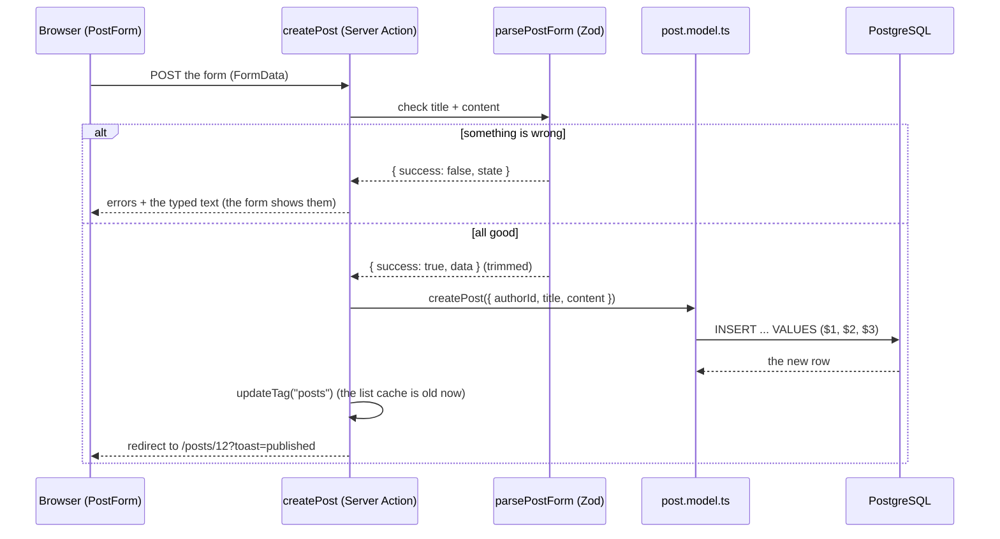
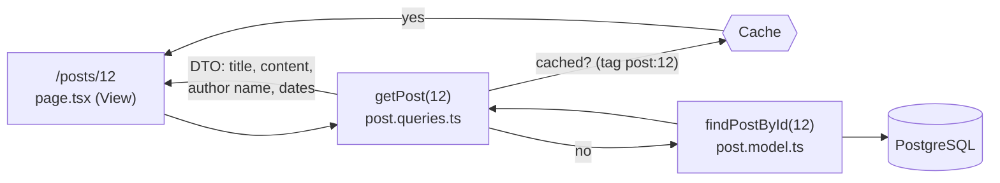

# M2 — Posts CRUD with MVC

> **Goal:** people can write, read, edit and delete posts in the browser, and every part of the
> code has one clear job: Model, View or Controller.
>
> Metaphor: a restaurant.
> The **Model** is the kitchen (only it touches the food, the database).
> The **Controller** is the waiter (takes the order, checks it, asks the kitchen, brings the plate).
> The **View** is the plate and the menu (shows things, never goes into the kitchen).

## What we built

- **4 pages** from the design canvas: the post list (`/`), one post (`/posts/12`), write (`/posts/new`)
  and edit (`/posts/12/edit`). Plus a 404 page, an error page, loading skeletons and toast messages.
- **Controllers** in `src/controllers/`:
  - `post.queries.ts`: the reads. Cached, and they return small **DTOs**, never whole database rows.
  - `post.actions.ts`: the changes (create, update, delete) as **Server Actions**.
- **Validation** in `src/lib/validation/post.ts`: the rules for a post (your Task 1 and Task 2).
- **"Older posts"** paging with `?before=<id>` (the keyset pagination from M1, now on screen).
- **ESLint layer rules**: a page that imports a model, or a model that imports Next.js, fails CI.
- **Playwright**: a real browser writes, edits and deletes a post. It runs in CI too.
- Until M3 (login) every new post belongs to the seeded `demo` user. Until M4 anyone can edit or
  delete any post. We know, and we fix it there.

## Key words

| Word                        | Simple meaning                                                                      | Metaphor                                         |
| --------------------------- | ----------------------------------------------------------------------------------- | ------------------------------------------------ |
| **CRUD**                    | Create, Read, Update, Delete: the 4 things you do with data                         | The 4 buttons on a remote                        |
| **MVC**                     | Model (data), View (screen), Controller (in between)                                | Kitchen, plate, waiter                           |
| **Server Action**           | An async function marked `"use server"` that a form can call; it runs on the server | Ringing the bell for the waiter                  |
| **Zod schema**              | A list of rules that checks data and gives friendly messages                        | The bouncer's checklist at the door              |
| **`useActionState`**        | A React hook: runs the action and gives you its result (errors) and `pending`       | The order ticket that comes back to your table   |
| **DTO**                     | A small plain object with only what the page needs                                  | A receipt, not the whole cash register           |
| **Cache + tag**             | Save a result to reuse it; a tag is its name, so we can throw it away later         | Pre-cooked dishes with a label on the lid        |
| **`updateTag`**             | "This cached dish is old now, cook it fresh next time"                              | Peeling off the label and binning the dish       |
| **Static shell + Suspense** | The page frame is sent at once; slow parts stream in later, with a skeleton first   | The table is set while the food is still cooking |
| **E2E test**                | A test where a real browser clicks through the real app                             | A mystery shopper                                |

## The journey of "Publish post"



Notice the order: **check first, then touch the database**. And the controller never writes SQL:
it asks the model.

## The journey of reading a post



The first visitor waits for the database. Everyone after gets the cached copy, until an edit calls
`updateTag("post:12")`.

## Run it yourself

M2 is built on top of M1, so get the branch the same way as before
(after PR #4 is merged, the branch is rebuilt on the new `main`):

```bash
git fetch origin
```

```bash
git checkout -B tnt57/focused-hopper-v5osaw origin/tnt57/focused-hopper-v5osaw
```

```bash
pnpm install
```

Start the database, create the tables and add the demo user and posts, all in one command
(it runs `db:up`, `db:migrate` and `db:seed`; the demo user is needed to write posts until M3):

```bash
pnpm db:setup
```

```bash
pnpm dev
```

Open <http://localhost:3000>. Click around: open a post, write one, edit it, delete it.

To run the browser tests, install Playwright's browser once:

```bash
pnpm exec playwright install chromium
```

```bash
pnpm test:e2e
```

## Your turn

Same as M1: the tests are already written and **red**. Both tasks are in **one file**:
`src/lib/validation/post.ts`. Do Task 1 first: Task 2 can't fail before there are rules.

```bash
pnpm test:unit
```

You will see **12 red unit tests**. `pnpm test:db` adds 2 more (the actions), so 14 in total.
Each task below says exactly which ones it turns green.

### Task 1: the rules (`postSchema`)

Replace the 2 `z.string()` lines with the real rules:

| Field     | Rules (in this order)                     | Error message (exactly)                       |
| --------- | ----------------------------------------- | --------------------------------------------- |
| `title`   | remove spaces at both ends                |                                               |
|           | at least 1 character                      | `Title is required.`                          |
|           | at most `TITLE_MAX` (120) characters      | `Title must be 120 characters or fewer.`      |
| `content` | remove spaces at both ends                |                                               |
|           | at least `CONTENT_MIN` (10) characters    | `Content must be at least 10 characters.`     |
|           | at most `CONTENT_MAX` (20 000) characters | `Content must be 20 000 characters or fewer.` |

Hints:

- Zod rules are a chain: `z.string().trim().min(1, "message").max(120, "message")`.
- `.trim()` runs first, so `"   "` becomes `""` and then fails `.min(1)`. That's how "only spaces" is caught.
- Use the constants (`TITLE_MAX` and friends), so the form's counter and the rules can never disagree.

Done when: `tests/unit/post-schema.test.ts` is green (8 tests), plus "returns the clean data when the
form is valid" in `tests/unit/parse-post-form.test.ts`.

### Task 2: the "validation failed" branch

In `parsePostForm()`, replace the `throw new Error("TODO(you)...")` with a `return`:

- `success: false`
- `state.values`: what the user typed, **unchanged** (it's already in the `values` variable)
- `state.errors`: one list of messages per field, like `{ title: ["Title is required."] }`

Hint: Zod can build that errors object for you. Look for **`z.flattenError`** in the
[Zod docs](https://zod.dev/error-formatting). You want its `fieldErrors`.

Done when the "(Task 2)" tests are green: 4 in `tests/unit/parse-post-form.test.ts`, 2 in
`tests/db/post.actions.test.ts`, and the browser test "a form with problems explains them and keeps the text".
Then try it in the browser: type only spaces as the title and `joins` as the content, and press Publish.

**Bonus (2 minutes):** in Task 2, return `values: { title: "", content: "" }` instead of the typed values.
Which test turns red? Now try the form in the browser. Why is this a bad experience?

### When both tasks are green

```bash
pnpm check
```

```bash
git add src/lib/validation/post.ts
```

```bash
git commit -m "feat(posts): add the post validation rules"
```

(If you did both tasks before committing, one commit is fine. Two small commits tell the story better.)

```bash
git push
```

## Never trust the browser: 3 checks, 3 jobs

| Where                              | What it checks                   | Why it's there                                                                     |
| ---------------------------------- | -------------------------------- | ---------------------------------------------------------------------------------- |
| The form (`required`, `maxLength`) | Empty fields, too long           | Comfort: instant feedback. **Anyone can skip it** (DevTools, curl, a script).      |
| Zod in the Server Action           | All the rules, friendly messages | The real check. A Server Action is a **public endpoint**: any POST can reach it.   |
| PostgreSQL `CHECK`                 | The same limits                  | The last guard, for anything that skips the app (a bug, a script, a typo in psql). |

Zod may be **stricter** than the database (content needs 10 characters, the database only 1), but
**never looser**. If Zod lets something through that the database refuses, the user gets the error page.
Try it: with Task 1 not done yet, submit a title of only spaces. The database refuses it, and you see "Something went wrong".

## Caching in one minute

- `getPostPage()` and `getPost()` start with `"use cache"`. Next.js saves their result and reuses it.
- `cacheTag("posts")` names the saved result. After a change, `updateTag("posts")` throws it away,
  so the author sees their change **at once** ("read your own writes").
- **Bug hunt:** delete the `updateTag("posts")` line in `createPost`, run `pnpm build && pnpm start`,
  and publish a post. Is it on the home page? (Put the line back.)
- Why does `/posts/999` answer with status **200** and not 404? The page frame is already streaming
  when we find out the post doesn't exist. Next.js still shows the 404 page and adds `noindex`,
  so search engines skip it. (The [Next.js docs](https://nextjs.org/docs/app/api-reference/functions/not-found) explain this.)

## Next.js keeps old pages alive (and why it matters)

When you leave a page, Next.js 16 **hides** it instead of throwing it away (React `<Activity>`),
so "Back" finds it as you left it. Nice, but it surprised us 3 times while building M2:

1. **Two forms on one page.** The hidden "New post" form and the visible "Edit post" form both had
   `id="post-title"`, so the label pointed to the hidden one. Fix: React's `useId()` gives every form its own ids.
2. **Old text after publishing.** After a successful publish, "New post" showed the old text again.
   Fix: `PostForm` starts a fresh form when it's hidden right after a submit (a draft you didn't send is kept).
3. **Tests found hidden elements.** Fix: tests use `getByRole(...)`, which only sees what is visible.

## Common mistakes

- **Trusting the form.** `required` in HTML is not security. Always validate in the Server Action.
- **Exporting a helper from a `"use server"` file.** Every export becomes a public endpoint. Keep helpers
  un-exported, or put them in `src/lib/`.
- **Forgetting `updateTag` after a change.** The data is saved, but people see the old cached page.
- **A view importing a model.** ESLint stops you: ask a controller instead.
- **Clearing the form on an error.** The user loses their text. Return the typed values.
- **Using a link for "Delete".** Links can be opened by prefetching. Changes are always a form + POST.

## Try it yourself

1. In the browser, open DevTools → Network, then publish a post. Find the `POST` request. That's the
   Server Action. What does it send?
2. Break a layer rule: in `src/app/page.tsx`, add `import { listPosts } from "@/models/post.model";`
   and run `pnpm lint`. Read the message, then remove the line.
3. Add 25 posts (publish a few, or change the seed), then use "Older posts". Look at the URL.
   Change `?before=` by hand to `abc`. What happens, and which function made that safe?

## Interview questions you can now answer

- **What is MVC, and why use it?** Model = data and SQL, View = what the user sees, Controller = checks
  the request and connects the two. Each part has one job, so you can change one without breaking the others
  (in M8 we swap the whole Model layer to Drizzle).
- **Why validate on the server if the form already checks?** The browser is not under your control.
  Anyone can send any request to a Server Action.
- **What is a DTO, and why return one?** A small object with only the fields the page needs, so secrets
  like `password_hash` can never reach the browser by accident.
- **How does the page show new data right after a change, if it is cached?** The action calls
  `updateTag`, which throws away the cached copy, so the next request reads fresh data.
- **What is an E2E test, and how is it different from a unit test?** A unit test checks one function.
  An E2E test drives a real browser through the real app, database included.
- **Why is Delete a form and not a link?** A GET (a link) must never change data: browsers, prefetching
  and crawlers open links on their own. Changes use POST.
