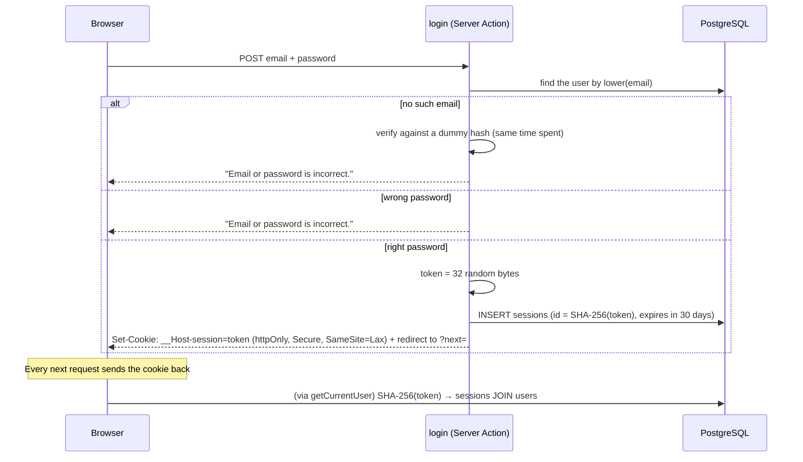

# M3 — Authentication: register, log in, log out

> **Goal:** people can create an account, log in and log out, and every new post belongs to the person who wrote it.
>
> Metaphor: a hotel.
> **Register** is the check-in desk. The hotel never writes down your PIN, only its **fingerprint** (a hash).
> **Logging in** gives you a **key card** (a session token). The hotel keeps only a fingerprint of each card,
> so a thief who steals the hotel's records can't make cards.
> Your **wallet** is the **cookie** where the browser keeps the card. **Log out** = the desk cancels your card.

## What we built

- `0003_create_sessions.sql`: the `sessions` table. It stores the **SHA-256 of the token**, never the token itself.
- **Passwords** (`src/lib/auth/password.ts`): **Argon2id** with OWASP's settings (19 MiB memory, 2 passes).
- **Sessions** (`src/controllers/session.ts`):
  - `startSession()`: a random 32-byte token goes into the cookie, its hash into the database. Fixed 30 days.
  - `getCurrentUser()`: cookie → hash → `sessions JOIN users` → the user, or `null` (missing, made up or expired).
  - `endSession()`: deletes the row, so even a copied token stops working.
  - `requireUser()`: the user, or a redirect to `/login?next=…`.
- **Server Actions** (`src/controllers/auth.actions.ts`): `register`, `login`, `logout`.
- **Pages**: `/register` and `/login` (from the design boards), and a user menu in the header
  (with the phone menu button from the HomePhone board).
- **Posts now need a login**: new posts belong to you (not to `demo`), and every post action checks the session itself.
  (Until M4, any logged-in user can edit any post. M4 adds "only the author or an admin".)
- **`proxy.ts`**: a quick redirect to the login page when there's no cookie at all. Comfort, not security.
- The Vercel build no longer runs the seed: real people sign up now. The demo user can never log in
  (its password hash is `"!"`, which no password matches).

## Key words

| Word                       | Simple meaning                                                                        | Metaphor                                     |
| -------------------------- | ------------------------------------------------------------------------------------- | -------------------------------------------- |
| **Authentication** (AuthN) | Who are you? (log in)                                                                 | Showing your passport                        |
| **Authorization** (AuthZ)  | What may you do? (M4)                                                                 | Which rooms your key card opens              |
| **Hash**                   | A one-way fingerprint of data. You can check against it, never turn it back           | A fingerprint                                |
| **Encryption**             | Two-way: locked with a key, and unlocked with a key                                   | A safe                                       |
| **Salt**                   | Random bytes mixed into each password hash, so 2 equal passwords get different hashes | A unique ink colour for each fingerprint     |
| **Session**                | The server remembers "this token = this user, until this date"                        | The hotel's list of active key cards         |
| **Cookie**                 | A small value the browser sends back with every request to the same site              | Your wallet, shown at the door every time    |
| **Timing attack**          | Learning a secret by measuring how long the server takes to answer                    | Guessing a lock by listening to the clicks   |
| **Open redirect**          | A site that can be tricked into sending you to another site                           | A receptionist who sends you to a fake hotel |

## Hashing is not encryption

|                       | Encryption (a safe)                         | Hashing (a fingerprint)                       |
| --------------------- | ------------------------------------------- | --------------------------------------------- |
| Can you undo it?      | Yes, with the key                           | **No**                                        |
| If the database leaks | With the key, every password is readable    | The attacker must **guess** each password     |
| Use it for            | Data you need to read again (a credit card) | **Passwords**: we only ever need to _compare_ |

Why **Argon2id** and not SHA-256 for passwords? People choose weak passwords. SHA-256 is built to be **fast**:
an attacker can try billions of guesses per second. Argon2id is built to be **slow and memory-hungry**
(about 14 ms and 19 MiB per try), so guessing becomes very expensive.
Session tokens are different: they are 32 random bytes nobody can guess, so a fast SHA-256 is enough for them.

## The journey of "Log in"



**Why one message for both failures?** If "unknown email" and "wrong password" got different messages, anyone could
use the login form to find out **who has an account** here. Same for the time: with no user, we still run one
Argon2 check against a dummy hash, so a fast answer doesn't give it away either.

## Cookie safety settings (Task 1 is about these)

| Setting               | What it does                                                                         | Stops                                                             |
| --------------------- | ------------------------------------------------------------------------------------ | ----------------------------------------------------------------- |
| `httpOnly: true`      | JavaScript in the page **can't read** the cookie (`document.cookie` doesn't show it) | Stealing the session with an XSS bug (M7)                         |
| `secure: true` (prod) | The cookie is only sent over **https**                                               | Reading it on public Wi-Fi                                        |
| `sameSite: "lax"`     | The cookie is **not** sent when another site starts a POST to us                     | CSRF: a hidden form on evil.example that posts to our site as you |
| `path: "/"`           | Valid for the whole site                                                             |                                                                   |
| `expires`             | A fixed end date: 30 days after login                                                | Sessions that live forever                                        |
| Name `__Host-session` | The browser only accepts it if `Secure`, `Path=/` and no `Domain`                    | Another site (even a subdomain) overwriting our cookie            |

`secure` is only on in production, because some browsers refuse a Secure cookie on `http://localhost`.
And you will see the `__Host-` rule in action: without `secure`, browsers **throw the production cookie away**.
That's why most browser tests in CI fail until Task 1 is done, while they pass on your laptop (`pnpm dev`
uses the plain name `session`).

## Run it yourself

```bash
pnpm db:migrate
```

```bash
pnpm dev
```

Then: **Sign up** → write a post → **Log out** → try a wrong password → log in. Open DevTools → Application →
Cookies: find `session`. After Task 1, the **HttpOnly** column has a tick. In the Console, type
`document.cookie`: the session cookie isn't there.

## Your turn

### Task 1: the cookie settings

In **`src/lib/auth/cookie.ts`**, `sessionCookieOptions()` returns only `path` and `expires`. Add the 3 safety settings
from the table above:

| Setting    | Value                                                           |
| ---------- | --------------------------------------------------------------- |
| `httpOnly` | `true`                                                          |
| `secure`   | `true` in production, `false` on localhost (hint: `production`) |
| `sameSite` | `"lax"`                                                         |

Then delete the line `void production; ...`, which was only there so the unused parameter doesn't upset the linter.

```bash
pnpm test:unit session-cookie
```

Done when **6 passed**.

### Task 2: write a test yourself

This time you write the **test**, not the code. In **`tests/db/auth.actions.test.ts`**, find the test
`"refuses a wrong password with exactly the same message (Task 2)"` and replace the `throw new Error(...)` line.

Your test should:

1. log in as `trung@example.com` (the `beforeEach` already registered him, with the password `"coffee and code"`)
   with a **wrong** password, and keep the returned state;
2. log in with an email that **doesn't exist**, and keep that state too;
3. check (with `expect`) that:
   - the wrong-password state's `error` is `"Email or password is incorrect."`;
   - both `error`s are **exactly the same**;
   - **no cookie** was set: `cookieJar.values.size` is `0`.

Hint: the test just above it, `"refuses an unknown email with the general message"`, shows how to call `login`
with `emptyLogin` and `form({...})`.

```bash
pnpm test:db auth.actions
```

Done when it's green. **Then check that your test can fail** (a test that can never fail is useless):
in `src/controllers/auth.actions.ts`, change the wrong-password line to return `error: "Wrong password."`, run the test
again: it must turn **red**. Change it back.

### When both are green

```bash
pnpm check
```

```bash
git add src/lib/auth/cookie.ts tests/db/auth.actions.test.ts
```

```bash
git commit -m "feat(auth): secure the session cookie and test login errors"
```

```bash
git push
```

## Common mistakes

- **Storing the password, or encrypting it.** Hash it, with a slow hash (Argon2id, bcrypt, scrypt).
- **Different messages for "no such user" and "wrong password".** It tells attackers who has an account.
- **Storing the session token itself.** Store its hash: a database leak then logs nobody in.
- **Trusting the hidden button.** Hiding "Edit" for guests is comfort. The action must check the session itself.
- **`proxy.ts` as security.** It only sees that _a_ cookie exists, not whether it's real.
- **`?next=` without a check.** `/login?next=https://evil.example` becomes a phishing tool (an open redirect).
- **A logout link.** Logging out changes data, so it's a form + POST.

## How a library like Better Auth does the same thing

Companies often use a library such as **Better Auth** (or Auth.js) instead of writing auth themselves.
Under the hood it does what you just learned: hashes passwords, stores sessions in the database, sets an
`httpOnly` cookie, and checks the session on the server. Because you built it once by hand, you can now
configure such a library knowing _what_ each option protects.

## Interview questions you can now answer

- **Hashing vs encryption?** Encryption can be undone with a key; hashing can't. Passwords are hashed because we
  only need to compare them.
- **Why a slow hash for passwords?** To make guessing expensive. A fast hash lets an attacker try billions per second.
- **What is a salt?** Random data added to each password before hashing, so equal passwords get different hashes and
  pre-made tables of hashes are useless.
- **Sessions vs JWT?** A session is a random id the server looks up in its database, so logging out deletes it at once.
  A JWT carries signed data in the token itself: no lookup needed, but you can't easily cancel one before it expires.
- **What do httpOnly, Secure and SameSite do?** httpOnly: page scripts can't read the cookie. Secure: only over https.
  SameSite=Lax: not sent on cross-site POSTs, which blocks CSRF.
- **What is a timing attack, and how did we stop one?** Measuring response times to learn secrets. Unknown emails still
  run one Argon2 check against a dummy hash, so both cases take about the same time.
- **What is an open redirect?** A site that sends users to any URL from a parameter. We only accept paths that start
  with a single `/`.
