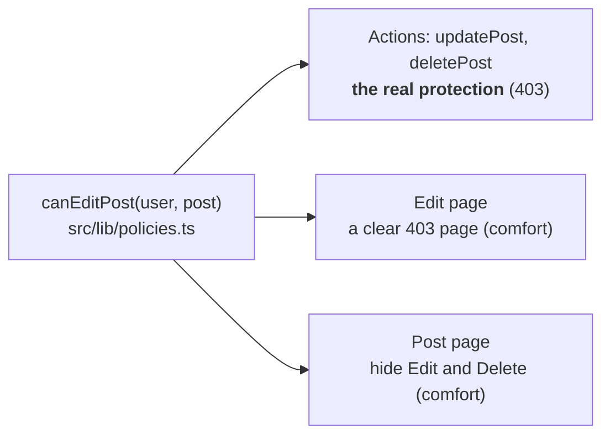
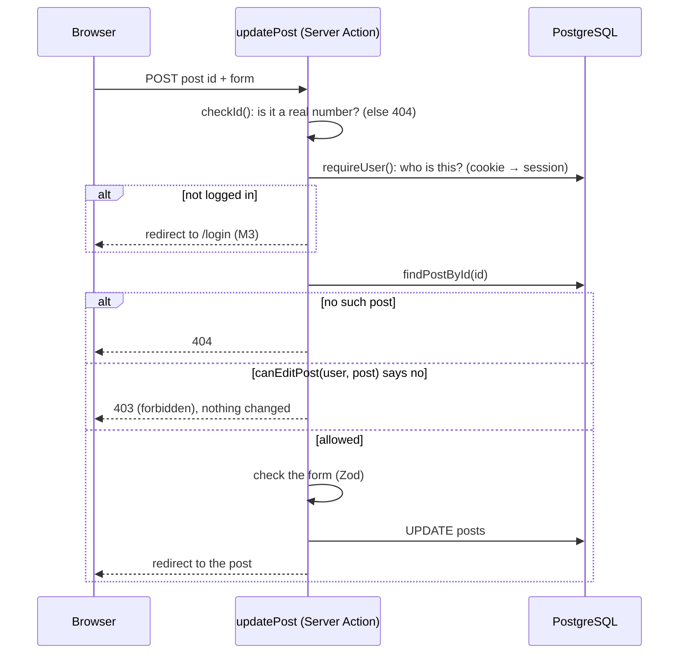

# M4 — Authorization: only the author (or an admin) can change a post

> **Goal:** you can edit and delete **your own** posts. Other people can read them, but not change them.
> An **admin** can change any post (for example, to remove spam).
>
> Metaphor: an apartment building.
> M3 gave everyone a **key card**, so the building knows **who you are** (authentication).
> M4 decides **which doors your card opens** (authorization). Your card opens **your** apartment only.
> The building manager (the **admin**) has a **master key**. A visitor without a card opens nothing.

## What we built

- **`src/lib/policies.ts`**: `canEditPost(actor, post)`, **the one rule** for "may this person change this post?".
  It's a pure function (no database, no cookies), so it's easy to test.
- **The actions** (`src/controllers/post.actions.ts`): `updatePost` and `deletePost` now load the post and ask the rule
  **before** changing anything. No such post → 404. Not allowed → **403** with `forbidden()`.
- **The edit page**: someone else's post shows the new **403 page** (`src/app/forbidden.tsx`).
- **The post page**: Edit and Delete only show when the rule says yes.
- **`next.config.ts`**: `forbidden()` is still **experimental** in Next.js 16, so we turn it on with
  `experimental: { authInterrupts: true }`.
- The post DTO (`PostDetail`) now includes `authorId`, so the page can ask the rule.

## Key words

| Word                       | Simple meaning                                                                | Metaphor                                   |
| -------------------------- | ----------------------------------------------------------------------------- | ------------------------------------------ |
| **Authentication** (AuthN) | Who are you? (M3)                                                             | Showing your key card at the front door    |
| **Authorization** (AuthZ)  | What may you do? (M4)                                                         | Which doors your card opens                |
| **Owner**                  | The user who created something (`posts.author_id`)                            | The person who rents the apartment         |
| **Role**                   | A group with its own permissions (`users.role`: `user` or `admin`)            | Tenant or building manager                 |
| **Policy**                 | A rule written as code: `canEditPost(actor, post)`                            | The building's rule book                   |
| **IDOR**                   | Changing an id in a request to reach someone else's data                      | Trying door 8 when you live in 7           |
| **Deny by default**        | Say "yes" only in the cases you listed. Everything else is "no"               | A new card opens nothing until it's set up |
| **Broken Access Control**  | Any bug where people can do more than they should. **#1 in the OWASP Top 10** | A master key that anyone can borrow        |

## 401, 403 or 404?

| Code    | Means                                                | In our app                                                            |
| ------- | ---------------------------------------------------- | --------------------------------------------------------------------- |
| **401** | "We don't know who you are." (really: not logged in) | We **redirect to `/login`** instead (`requireUser()`, M3)             |
| **403** | "We know who you are, but **no**."                   | `forbidden()` → `src/app/forbidden.tsx`: "You can't change this post" |
| **404** | "There is no such thing."                            | `notFound()` → `src/app/not-found.tsx`                                |

Some sites answer **404 instead of 403** on purpose, so strangers can't even learn that something exists
(GitHub does this for private repositories). Our posts are public anyway, so an honest 403 is clearer.

**Status code note:** our check runs inside `<Suspense>`, after the page has started streaming, so the browser
gets status **200** with the 403 page inside (plus a `noindex` tag). It's the same as `notFound()` in M2.

## One rule, three places



Why **one** function? If the rule is copied into 3 files, one day someone changes 2 of them and forgets the third.
Then the button and the action disagree, and that's how security bugs are born.

## The journey of "Save changes"



Notice the order: **who are you → may you → is your input OK**. We check the permission **before** the form,
so a stranger gets "403" and nothing else. They don't even learn the form's rules.

## IDOR: "just change the number"

Before M4, any logged-in user could open `/posts/8/edit`, even if post 8 was someone else's. Or skip the page
and POST straight to the action with id 8. Changing an id like this is called **IDOR**
(Insecure Direct Object Reference), and it's one of the most common bugs in real apps.

The fix is never "hide the id". The fix is: **every time** someone asks to change thing #8, the server
checks that #8 is **theirs** (or that they're an admin).

## Make yourself an admin

There's no admin page (yet). Change your role with SQL:

- **Live site:** Neon console → your database → **SQL Editor**:

  ```sql
  UPDATE users SET role = 'admin' WHERE username = 'your_username';
  ```

- **Laptop (Docker):**

  ```bash
  docker compose exec db psql -U study -d study_blog -c "UPDATE users SET role = 'admin' WHERE username = 'your_username';"
  ```

It works on your next click, no need to log in again: `getCurrentUser()` reads your role from the
database on **every** request. (With a JWT, the old role would stay inside the token until it expires: the
sessions-vs-JWT trade-off from M3.)

## Run it yourself

1. `pnpm dev`, then sign up as **user A** and write a post.
2. Open a **private window** (it has its own cookies) and sign up as **user B**.
3. As B, open A's post: no Edit or Delete buttons.
4. As B, type `/posts/<id>/edit` in the address bar: the 403 page.
5. Make B an admin (above), reload A's post: B sees the buttons now.

## Your turn

### Task 1: the rule

In **`src/lib/policies.ts`**, `canEditPost()` still has M3's rule: "anyone who is logged in". Write the real rule:

| Who is asking               | Answer  |
| --------------------------- | ------- |
| a guest (`actor` is `null`) | `false` |
| an admin (`actor.role`)     | `true`  |
| the post's author           | `true`  |
| anyone else                 | `false` |

Hints:

- Check `null` **first**. TypeScript won't let you read `actor.role` before you have (try it!).
- The author check compares two ids: the actor's `id` and the post's `authorId`.
- Delete the line `void post; ...`.

```bash
pnpm test:unit policies
```

```bash
pnpm test:db post.actions
```

Done when everything is green **except** the Task 2 test.

### Task 2: write the admin test

In **`tests/unit/policies.test.ts`**, find `"lets an admin edit anyone's post (Task 2)"` and replace the
`throw new Error(...)` line. Your test should:

1. make an admin: a new `Actor`, like `trung` and `lan` at the top of the file, but with the role `"admin"`;
2. check (with `expect`) that `canEditPost` lets the admin edit `trungsPost`.

Then **check that your test can fail**: in `canEditPost`, remove the admin part of your rule. Your test must
turn **red**. Put it back.

### When both are green

```bash
pnpm check
```

```bash
git add src/lib/policies.ts tests/unit/policies.test.ts
```

```bash
git commit -m "feat(posts): only the author or an admin can change a post"
```

```bash
git push
```

## Common mistakes

- **Only hiding the button.** Anyone can still POST to the action. The action must check the rule itself.
- **Trusting an id from the form.** A hidden `<input name="authorId">` can be changed in DevTools. We take the
  user from the **session** and the author from the **database row**, never from the form.
- **Checking in the page but not in the action** (or the other way round). Use the same function in both.
- **Forgetting the guest.** `null` must be handled, or the code crashes, or worse, lets them in.
- **Allow by default.** "Everyone except X" breaks when a new kind of user appears. Write "only A or B".

## How bigger apps do the same thing

- **RBAC** (role-based access control): permissions by role. Our `admin` check is RBAC.
- **Ownership rules** (a kind of ABAC, attribute-based): permissions from the data itself, like `author_id`.
  Our rule mixes both.
- **Libraries** such as CASL or Oso keep many such rules in one place, like our `policies.ts`.
- **Postgres Row-Level Security**: the database itself refuses rows that aren't yours. Supabase apps use it a lot.

## Interview questions you can now answer

- **AuthN vs AuthZ?** Authentication checks who you are (login). Authorization checks what you may do
  (only your own posts).
- **401 vs 403 vs 404?** 401: not logged in. 403: logged in, but not allowed. 404: it doesn't exist (also used on
  purpose to hide that something exists).
- **What is IDOR, and how did you stop it?** Reaching someone else's data by changing an id. Every action loads the
  item and checks the owner on the server, every time.
- **The Edit button is hidden. Why check again on the server?** Server Actions are public endpoints: anyone can call
  them directly. The UI is comfort; the server check is security.
- **Where do your authorization rules live?** In one pure function (`canEditPost`), used by the actions and the
  pages, with unit tests for each case (author, admin, other user, guest).
- **What's #1 in the OWASP Top 10?** Broken Access Control: users doing more than they should.
