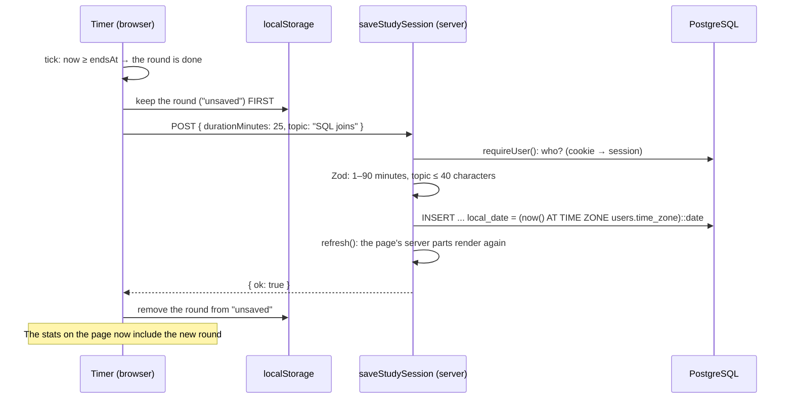

# M5 — Pomodoro timer + study stats

> **Goal:** a timer on the Study page. Focus for 25 minutes, then a short break; after 4 rounds, a long break.
> Every finished focus round is saved, and the page shows your stats: today, this week, the last 7 days,
> and your top topics.
>
> Metaphor: a **kitchen timer** and a **diary**.
> The timer sits on **your desk** (the browser): it ticks, it rings, and sticky notes on the desk
> (**localStorage**) remember where it was. The **diary** is kept at the **library** (the database):
> only finished rounds go in, written by the librarian (the server), who checks the date herself.

## What we built

- **`0004_create_study_sessions.sql`**: one row per finished focus round, with the user's **own** calendar day
  (`local_date`), set by the database from `users.time_zone`.
- **The rules** (`src/lib/pomodoro.ts`): pure functions (`start`, `pause`, `nextStep`, `secondsLeft`...).
  No React and no real clock inside, so every rule is tested in milliseconds.
- **The timer** (`src/components/study/pomodoro-timer.tsx`): a **Client Component**. It ticks, plays a short sound,
  changes the tab title to "Break time!", and keeps its state in **localStorage** (per user), so a reload keeps
  "Round 2 of 4" and a running clock.
- **Timer settings** (a native `<dialog>`, a bottom sheet on phones): lengths, daily goal, sound. Saved in this browser only.
- **The save** (`saveStudySession`, a Server Action): the browser sends only `{ durationMinutes, topic }`.
  The server decides **who** (the session cookie) and **when** (the database clock).
- **"Couldn't save. Retry"**: a finished round is kept on the device **first**, then sent. It leaves the device
  only after the server says "saved", so a lost connection never loses a round.
- **The stats** (`study.queries.ts` → 6 small SQL queries), shown by a **Server Component**. After each save,
  `refresh()` asks the browser to load them again.
- **A browser test with a fake clock** (`e2e/study.spec.ts`): a 25-minute round takes 1 second.
- **Cleaner production logs:** Neon's `sslmode=require` becomes `sslmode=verify-full` (`src/lib/env.ts`):
  the same safety, without pg's long warning on every start.

## Key words

| Word                 | Simple meaning                                                                      | Metaphor                                   |
| -------------------- | ----------------------------------------------------------------------------------- | ------------------------------------------ |
| **Server Component** | Runs on the server only. Can use the database and secrets. Sends HTML               | The kitchen: cooks, then sends the plate   |
| **Client Component** | `"use client"`: also runs in the browser. Can use clicks, state, timers             | A waiter at your table who reacts to you   |
| **State**            | Data that changes while you use the page (time left, mode, round)                   | The position of the timer's dial           |
| **localStorage**     | A small key → text store in the browser. Survives reloads, never sent to the server | Sticky notes on your own desk              |
| **Hydration**        | React "wakes up" the server's HTML in the browser and attaches the click handlers   | Turning on a printed control panel         |
| **Timestamp**        | A moment in time, as milliseconds since 1970                                        | "The alarm rings at 10:25", not "in 5 min" |
| **Aggregate**        | SQL that turns many rows into one number: `SUM`, `COUNT`                            | Adding up the diary's pages                |
| **COALESCE**         | "the first value that isn't NULL": `COALESCE(SUM(x), 0)`                            | "If the box is empty, write 0"             |
| **Local date**       | The calendar day **where the user is**, not where the server is                     | Your own wall calendar                     |

## Server or browser? Where each part of /study runs

| Runs on the server                                        | Runs in the browser (`"use client"`)                       |
| --------------------------------------------------------- | ---------------------------------------------------------- |
| `StudyPage`: the heading (static shell)                   | `PomodoroTimer`: ticks, buttons, sound, tab title          |
| `StudyBoard`: `requireUser()` reads the cookie            | `TimerSettingsDialog`: the settings form                   |
| `StudyStats`: `getStudyStats()` runs the SQL              | `GoalProgress`: "2 of **4**" (the goal is in localStorage) |
| `StudyStatsView`: turns numbers into HTML (no JavaScript) |                                                            |

The rule of thumb: **data and secrets → server; clicks, timers and browser storage → client.**
`GoalProgress` is a tiny "client island" inside the server's stats: the server knows how many rounds you did today,
but only the browser knows your daily goal.

## localStorage or the database?

|                    | localStorage (sticky notes)                  | Database (the diary)             |
| ------------------ | -------------------------------------------- | -------------------------------- |
| Where              | This browser only                            | The server                       |
| Other devices?     | No                                           | Yes, every device you log in on  |
| Can the user edit? | **Yes**, in DevTools                         | Only through our checked actions |
| We keep            | Timer state, settings, topic, unsaved rounds | Finished rounds (your history)   |

Two traps we avoided:

- **localStorage belongs to the browser, not to a person.** If Trung and Lan share a laptop, Lan must never see,
  or save, Trung's unsaved round. So every key includes the user id: `study-blog:user-7:timer`.
- **The server can't read localStorage.** The server's HTML always shows the defaults (25:00), then the browser
  switches to the saved values. `useSyncExternalStore` does that switch without a "hydration mismatch" error.

## Why the timer stores WHEN it ends, not "seconds left"

A simple timer does "seconds = seconds − 1" every second. But browsers **slow down timers in background tabs**
(sometimes to once a minute). Leave the tab for 10 minutes and that timer is minutes behind.

We store `endsAt`, the moment the round ends. Each tick computes `endsAt − now`. Late ticks don't matter:
the answer is always right. When you come back to the tab, we check at once (`visibilitychange`).

## The journey of a finished round



If the POST fails (offline), the round stays in "unsaved", and the page shows **"Couldn't save. Retry"**.

## Time zones: why `local_date`?

Trung studies at **8 am on Friday in Adelaide**. In UTC (the server's clock), it is still **9:30 pm on Thursday**.
If we used the server's date, his Friday morning round would land on Thursday's bar.

So the database works out the user's own day when it saves: `(now() AT TIME ZONE 'Australia/Adelaide')::date`.
The browser never sends a date: its clock can be wrong, or faked.

## The SQL behind the stats

- **Today:** `SUM(duration_minutes)` and `COUNT(*)` for one `local_date` (that's your Task 2).
- **The last 7 days:** `generate_series` makes one row **per day**, then a `LEFT JOIN` attaches the rounds.
  Days without rounds still appear, with `COALESCE(SUM(...), 0)` = 0. Without it, the chart would skip empty days.
- **This week:** `date_trunc('week', ...)` gives the Monday of the week (weeks start on Monday in Postgres).
- **Top topics:** `GROUP BY lower(topic)`, so "SQL joins" and "sql joins" count as one topic.

Remember M1's trap: `SUM` and `COUNT` return `bigint`, which pg turns into a **string** ("50"). So we always add `::int`.

## Run it yourself

```bash
pnpm db:migrate
```

```bash
pnpm dev
```

Open **Study**, type a topic, press **Start**. To test faster, open **Timer settings** and set Focus to 1 minute.
Then try these:

- Reload during a round: the clock goes on.
- Open DevTools → Application → Local Storage: find `study-blog:user-<id>:timer`.
- DevTools → Network → **Offline**, then finish a round: "Couldn't save". Go back online and press **Retry**.

## Your turn

### Task 1: `formatTime()`

In **`src/lib/pomodoro.ts`**, `formatTime()` just returns the seconds, so the timer shows `1500`. Make it a clock:

| Seconds | Shows   |
| ------- | ------- |
| 1500    | `25:00` |
| 65      | `01:05` |
| 59      | `00:59` |
| 0       | `00:00` |
| 5400    | `90:00` |

Hints:

- Minutes: `Math.floor(totalSeconds / 60)`. Seconds: `totalSeconds % 60` (the remainder).
- Two digits: `String(5).padStart(2, "0")` gives `"05"`.
- Join them with a template string: `` `${a}:${b}` ``. (In Python this whole task would be `f"{m:02d}:{s:02d}"`.)

```bash
pnpm test:unit pomodoro
```

### Task 2: the SQL for "minutes today"

In **`src/models/study-session.model.ts`**, `totalsOnDay(userId, day)` always returns zeros. Write the query that adds
up one user's rounds on one day. Fill in the 3 blanks:

```ts
const rows = await query<DayTotals>(
  `SELECT ___ AS minutes, ___ AS rounds
   FROM study_sessions
   WHERE ___`,
  [userId, day],
);
return rows[0];
```

Hints:

- `minutes`: the **sum** of `duration_minutes`. On a day with no rounds, `SUM` gives `NULL`, so wrap it in `COALESCE(..., 0)`.
- `rounds`: **count** the rows.
- Add `::int` to both (the bigint trap above).
- `WHERE`: this user (`$1`) **and** this day (`$2`, the column `local_date`). Never put the values into the SQL text.
- Delete the `void userId;` and `void day;` lines.

```bash
pnpm test:db study-session
```

### When both are green

```bash
pnpm check
```

```bash
git add src/lib/pomodoro.ts src/models/study-session.model.ts
```

```bash
git commit -m "feat(study): show the clock and add up today's minutes"
```

```bash
git push
```

## Common mistakes

- **Counting seconds with `setInterval`.** It drifts in background tabs. Store the end time.
- **Trusting the browser with the date or the user.** The server sets both. Extra fields in the request are ignored.
- **Forgetting `COALESCE`** (you get `null` instead of 0) **or `::int`** (you get `"50"` instead of 50).
- **One localStorage key for everyone.** Include the user id.
- **Reading localStorage while the server renders.** There is no `window` on the server: it crashes, or the HTML
  doesn't match. Read it in the browser (`useSyncExternalStore`).
- **Using the server's date for "today".** Use the user's time zone.

## What we chose not to do (yet)

- **A retried save could be saved twice** if the first one reached the server but the answer got lost. Real apps send an
  **idempotency key** (a unique id per round) and let the database refuse duplicates.
- **You could fake your own stats** by calling the action by hand. They are only your own numbers, so we accept it.
  A stricter server would refuse a round that finished sooner than its own length after the previous one.

## Interview questions you can now answer

- **Server vs Client Components?** Server Components run only on the server (database, secrets, no JavaScript sent).
  Client Components also run in the browser (state, effects, events). Use the server by default; add `"use client"`
  only where you need interaction.
- **localStorage vs cookies vs database?** localStorage: browser only, never sent, user-editable. Cookies: small, sent
  with every request (our login). Database: the shared, trusted record.
- **How do you make a timer accurate?** Store the end timestamp and compute "end − now" on each tick; never count ticks.
- **How do you handle time zones?** Store moments as `timestamptz` (UTC inside), and compute "which day" in the user's own
  time zone, on the server.
- **What do `COALESCE` and `generate_series` do here?** `COALESCE` turns "no rows" (NULL) into 0. `generate_series`
  makes a row for every day, so a `LEFT JOIN` can show days with nothing.
- **What is hydration, and a hydration mismatch?** React attaching to the server's HTML in the browser. A mismatch is
  when the browser's first render differs from that HTML (for example, reading localStorage too early).
- **How do you avoid losing data when a request fails?** Keep it locally first, send it, and delete the local copy only
  after the server confirms. Offer a retry.
