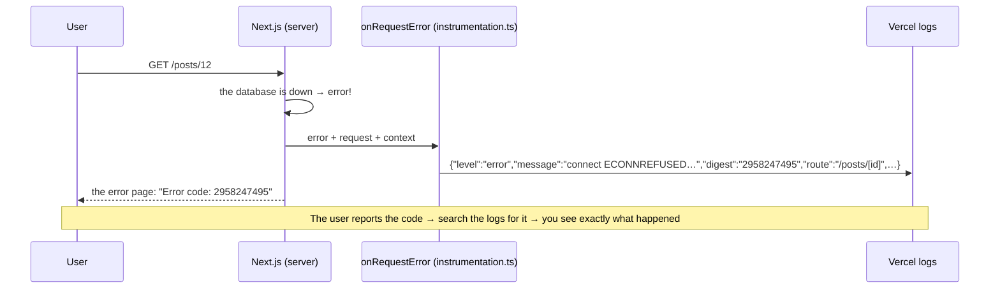

# M6 — Quality: browser tests, accessibility, error logs

> **Goal:** be sure the whole app works for **everyone**, and find out quickly when something breaks.
>
> Metaphor: a **car inspection** before a long trip.
>
> - **Browser tests** drive the car around the block: every pedal, every door.
> - **Accessibility checks** make sure anyone can drive it: with a wheelchair ramp, without seeing the dashboard.
> - **Error logs** are the plane's **black box**: when something goes wrong, they tell you what and where.
> - **Security updates** are the **recall notices**: the maker found a fault, so you swap the part.

## What we built

- **A security update first.** `next build` warned that Next.js 16.4.4 has a known vulnerability. We updated to
  16.4.6 (see "Keeping dependencies safe" below).
- **Accessibility checks** (`e2e/a11y.spec.ts`):
  - **axe** scans every page, as a visitor and as a member, on a desktop and on a phone. It also scans the
    states in between: login error, form errors, the delete dialog, the timer settings and the 403 page.
  - A **keyboard-only journey**: sign up, write a post and open the timer settings without a mouse.
  - It found one real problem: opening **Timer settings** left the keyboard focus nowhere useful. Fixed: the focus
    now starts in the first field.
- **Error logs** (`src/instrumentation.ts` + `src/lib/error-report.ts`): every server error becomes one JSON line in the
  logs, and the error page shows the same **error code** (the digest).
- **`global-error.tsx`**: the last safety net, when even the root layout breaks.
- **Test helpers** (`e2e/helpers.ts`): `writePost`, `logOut` and `tabTo`, so tests read like a story.
- **README:** a feature list and screenshots, for your portfolio.

## Key words

| Word                     | Simple meaning                                                                   | Metaphor                                   |
| ------------------------ | -------------------------------------------------------------------------------- | ------------------------------------------ |
| **E2E test**             | "End-to-end": a real browser clicks through the real app and database            | A test drive                               |
| **Testing pyramid**      | Many fast small tests at the bottom, a few slow whole-app tests at the top       | Check parts in the factory, then one drive |
| **Accessibility (a11y)** | Everyone can use it: screen readers, keyboard only, low vision, phones           | A ramp next to the stairs                  |
| **WCAG 2.2 AA**          | The world's standard rules for accessible websites. "AA" is the usual target     | The building code                          |
| **axe**                  | A tool that checks a page against many WCAG rules automatically                  | An inspector with a checklist              |
| **Focus**                | Which element the keyboard types into or presses right now                       | The cursor of a keyboard user              |
| **Observability**        | Being able to see what the app is doing in production, from its logs and numbers | A car's dashboard and black box            |
| **Digest**               | A short code Next.js gives each server error, shown to the user and in the logs  | A ticket number at the service desk        |
| **Security advisory**    | A public notice: "version X has this hole; version Y fixes it" (GHSA, CVE ids)   | A recall notice                            |

## The testing pyramid (our numbers)

```text
          ▲  14 browser tests (Playwright)      slow, but test everything together
         ▲▲▲  85 database tests (Vitest + Postgres)  models, actions, SQL
       ▲▲▲▲▲▲  131 unit tests (Vitest)               pure rules: fast, run in seconds
```

Why not only browser tests? They are slow (seconds each), and when one fails it doesn't say **which part** broke.
Small tests find the exact line. Browser tests prove the parts work **together**. You need both.

## Accessibility: what a machine can check, and what it can't

| axe can find                                   | axe can't know                                              |
| ---------------------------------------------- | ----------------------------------------------------------- |
| A form field with no label                     | Whether the label makes **sense**                           |
| Text with too little contrast                  | Whether the **Tab order** follows the page                  |
| An image with no `alt` text                    | Where the **focus** goes when a dialog opens (our bug!)     |
| Broken ARIA (`aria-*` attributes used wrongly) | Whether a screen reader user understands what just happened |

That's why we have both: axe for the rules a machine can check, and a **keyboard journey** that does what a
keyboard user does: Tab, Enter and Escape.

We also checked that axe can **fail**: on a copy of the login page with the labels removed, a low-contrast button
and an image without `alt`, it reported all 3 problems. A check that can't fail is useless.

## Error logs: from a crash to the exact line



We tested this for real: we stopped the database, opened a post, and the page's code matched the log line.

**Never put these in logs:** passwords, tokens, **cookies** (our login!), or personal data in the URL (`?email=…`).
Logs are read by more people and tools than the database is. `toErrorReport()` never copies the request headers,
and drops the `?query`. A unit test proves it.

On Vercel, open the project → **Logs**, and search for `"level":"error"` or the error code.

## Keeping dependencies safe

What happened in this milestone:

1. `next build` printed: **"Your version of Next.js is affected by a known security vulnerability."**
2. We looked it up: [GHSA-mfr8-8qww-v76h](https://github.com/advisories/GHSA-mfr8-8qww-v76h), **moderate**:
   information can leak when a `'use cache'` function is called through `unstable_cache()`.
3. We checked if **we** were exposed: we never call `unstable_cache()`, so no.
4. We updated anyway: 16.4.4 → 16.4.6 is a **patch** release (only fixes), so the risk is small. And "we're not affected
   today" can change tomorrow.
5. The update has its own commit, so it's easy to find (or undo) later.

Dependabot also opens update PRs every week. Read the change notes, let CI run, then merge.

## Run it yourself

```bash
pnpm build
```

```bash
pnpm test:e2e a11y
```

Then try the keyboard yourself: open the app, put the mouse away, and press **Tab**. The first Tab shows
"Skip to content". Can you write a post and start the timer with only Tab, Enter, Space and Escape?

## Your turn

### Task 1: a browser test, "a second user can't edit or delete my post"

M4 made the rule. Now prove it in a **real browser**, with **two real accounts**. In **`e2e/permissions.spec.ts`**, replace
the placeholder with this frame and fill in the **5 blanks** (`___`):

```ts
import { expect, test } from "@playwright/test";

import { logOut, registerNewUser, writePost } from "./helpers";

test("a second user can't edit or delete my post (Task 1)", async ({
  page,
}) => {
  // 1. Anna signs up and writes a post.
  await registerNewUser(page);
  const post = await writePost(page);

  // 2. Anna logs out, and Binh signs up.
  ___;
  ___;

  // 3. Binh can read Anna's post, but sees no Edit link and no Delete button.
  await page.goto(post.url);
  await expect(
    page.getByRole("heading", { level: 1, name: post.title }),
  ).toBeVisible();
  await expect(page.getByRole("link", { name: "Edit", exact: true })).___;
  await expect(page.getByRole("button", { name: "Delete", exact: true })).___;

  // 4. Binh types the edit address directly: the 403 page.
  await page.goto(___);
  await expect(
    page.getByRole("heading", { name: "You can’t change this post" }),
  ).toBeVisible();
});
```

Hints:

- Step 2: two helper calls from the `import` line. Each one needs `await` and `page`.
- Step 3: "there are **none** of these on the page" is `toHaveCount(0)`.
- Step 4: the post's address plus `/edit`. A template string joins them: `` `${post.url}/edit` ``.

```bash
pnpm test:e2e permissions
```

**Then check that your test can fail:** in `src/app/posts/[id]/page.tsx`, change `{canEditPost(user, post) && (` to
`{user && (` (the old M3 rule: anyone logged in sees the buttons). Your test must turn **red**. Change it back.

### When it's green

```bash
pnpm check
```

```bash
git add e2e/permissions.spec.ts
```

```bash
git commit -m "test(e2e): check that a second user can't change my post"
```

```bash
git push
```

## Common mistakes

- **Only browser tests.** Slow, and they can't tell you which line broke. Test the rules with fast unit tests too.
- **Selectors that need CSS classes or ids** (`.btn-primary`). Use `getByRole` and the text a person sees: the test
  then also checks accessibility, and survives a redesign.
- **"axe says 0 problems, so it's accessible."** Tools find about half of the problems. Use the keyboard yourself.
- **Logging the whole request.** It contains the login cookie. Log only what you need.
- **Ignoring dependency warnings.** Read them, check if you're exposed, update in a small commit.

## Interview questions you can now answer

- **What is the testing pyramid?** Many fast unit tests, fewer integration tests (ours use a real database), and a few
  end-to-end tests in a real browser. Each level catches different bugs; the lower ones are faster and more precise.
- **How do you test accessibility?** Automatically with axe (in CI, on every page and state), plus manual and scripted
  keyboard checks, because tools can't judge focus order or meaning.
- **What is WCAG, and what does AA mean?** The standard rules for accessible web content; AA is the level most laws and
  companies ask for (for example: 4.5:1 text contrast, every field labelled, everything usable by keyboard).
- **How would you debug an error a user reports in production?** Ask for the error code (digest), search the logs for it,
  read the route and message, then reproduce it locally with a test.
- **What must never be in logs?** Passwords, tokens, session cookies, and personal data.
- **How do you handle a security advisory in a dependency?** Read it, check if your code uses the affected feature,
  update to the fixed version in its own commit, and let CI prove nothing else broke.
